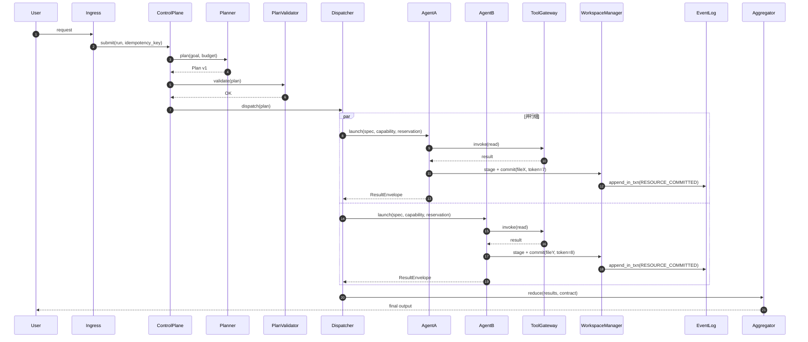

# 多子智能体派发与运行架构设计方案

**副题：从用户输入到最终输出的完整数据流、组件划分、提交协议与运行状态机**

| 项目 | 内容 |
|---|---|
| 版本 | **v0.2（评审修订版）** |
| 日期 | 2026-10-26 |
| 依据研究 | [四层读写分区与并发上下文设计](multi-agent-rw-partition-design.md) · [OS ↔ 多智能体双向映射](os-to-multiagent-mapping.md) |
| 修订说明 | v0.2 修复了 v0.1 评审发现的 10 个 P0 数据流缺陷，并吸收独立设计的协议补强（RSC 提交协议、fencing token、effect journal、capability token、预算树、计划版本化、适用性门控） |
| 形态 | 语言无关的架构规范 + 伪代码 + 时序图 |
| 状态 | **历史专题稿（已被 supersede）**：机制以 [设计规范 v1.12](multi-agent-harness-design-final.md) 为准；本文的「单调 fencing token」已被「按租约有效性 + `intents.is_valid(lease)`」取代 |

---

## 0. 设计目标与约束

### 0.1 目标

- 给出**端到端闭环**的数据流：每一步都有明确的产生者、传递路径、消费者。
- 给出**派发（dispatch）**完整流程：适用性门控 → 规划 → 校验 → 准入 → 实例化 → 启动。
- 给出**运行（run）**完整流程：执行循环、工具调用、**提交协议**、上下文更新、并发控制、失败恢复。
- 给出**协议级**保证：写何时生效、冲突谁裁决、崩溃后如何不重复副作用、权限如何不被绕过。
- 明确**组件边界**与**接口契约**，使实现者无需再做架构级决策。

### 0.2 硬约束

| 编号 | 约束 | 影响 |
|---|---|---|
| C1 | LLM 调用高延迟、按 token 计费、上下文有限且随长度退化；不能在 token 生成中途被抢占 | 锁不能跨 turn 持有；并发控制要短临界区 |
| C2 | agent 行为随机；失败以「静默语义错误」为主（Byzantine 式） | 输出校验必须是一等公民 |
| C3 | 工具副作用可能不可逆、非幂等 | 需要幂等键 + effect journal + 补偿 |
| C4 | 共享工作区写入立即可见，无原生事务与回滚 | 需要 overlay/stage/commit + Run 级基线 |
| C5 | 派生 subagent 是 O(context) 急切复制，按 token 计费 | 要适用性门控，避免无谓并行 |

### 0.3 设计原则

1. 分层抽象 + 统一接口（窄腰）
2. 机制与策略分离（**内核强制，模型提议**）
3. 快路径极便宜，慢路径才进「内核」
4. 乐观 + 兜底（预留不阻塞，提交时裁决）
5. 隔离与共享可调
6. 可观测性内建
7. 失败模式显式化
8. **临界区必须短**：LLM 推理期间绝不持有共享写锁

---

## 1. 术语约定（消除编号冲突）

> v0.1 的严重问题之一：资源分区 L0–L3 与架构分层 L0–L4 编号冲突。v0.2 起严格区分。

### 1.1 资源分区（Z0–Z3，对应内存段）

| 代号 | 名称 | 类比 | 读写 | 并发机制 | 失效方式 |
|---|---|---|---|---|---|
| **Z0** | 内核区 | 内核区 | 只读（运行期只追加） | 无锁读 / 单写者串行 | 不变 |
| **Z1** | 只读共享区 | 共享库映射 + text | 只读 | 无锁读 + 版本校验 | **永不失效** |
| **Z2** | 可读写共享区 | data + heap | 读写 | 预留-暂存-提交 + fencing + CAS | 事件失效 |
| **Z3** | 私有工作区 | stack | 读写 | 无锁（overlay） | agent 内失效 |

### 1.2 架构分层（P0–P5，对应平面）

| 代号 | 名称 | 职责 |
|---|---|---|
| **P5** | 接入面 | 用户输入、鉴权、会话、流式输出、HITL 审批台 |
| **P4** | 治理面 | 策略/能力、预算树、审计、评测/验证、密钥代理 |
| **P3** | 控制面 | Planner、PlanValidator、Dispatcher、Scheduler、Supervisor、Replanner、Aggregator |
| **P2** | 执行面 | AgentRuntime、ContextAssembler、ModelGateway、ToolGateway、WorkspaceManager、VerifierRunner |
| **P1** | 状态面 | EventLog、PlanStore、ArtifactStore、WorkspaceVersionStore、CheckpointStore、IntentRegistry、EffectJournal、MemoryStore |
| **P0** | 底座 | 沙箱/容器、FS overlay、网络出口、资源限制、模型/工具提供方 |

**五条边界规则**：
- B1：只有 P3 能修改 Plan/Task 状态（单一控制写入者）。
- B2：只有 P2 的 ToolGateway / WorkspaceManager 能产生外部副作用。
- B3：只有 P1 的 EventLog 能分配全局 `seq`；其他组件提交「事件意图」。
- B4：P4 的检查点在 gateway 强制执行，模型不可绕过。
- B5：P0 只提供隔离与资源，不提供语义。

---

## 2. 核心组件与职责

| 组件 | 平面 | 职责 | 强制点 |
|---|---|---|---|
| **Ingress** | P5 | 输入规范化、鉴权、用户请求幂等、创建 Run、流式输出 | 重复请求不重复建 Run |
| **ApplicabilityGate** | P3 | 判断是否值得多智能体 | 不满足则走单 agent |
| **Planner** | P3 | 任务分解、产出 Plan（TaskGraph + 契约 + footprint） | 只提议，不派发 |
| **PlanValidator** | P3 | schema/DAG/footprint/预算/深度扇出校验 | 非法计划 fail-closed |
| **Dispatcher** | P3 | 准入、预算预留、intent 注册、实例化 AgentSpec | 非阻塞 `try_admit` |
| **Scheduler** | P3 | dataflow ready 队列、优先级、老化、并发槽 | 不允许无限 defer 饥饿 |
| **Supervisor** | P3 | 心跳、租约、超时、重试、取消、孤儿回收 | 终态与 fencing 推进 |
| **Replanner** | P3 | 基于诊断生成 Plan patch（vN+1） | 有界重规划预算 |
| **Aggregator** | P3 | 按契约聚合、覆盖度检查、矛盾检测 | 不做自由发挥式总结 |
| **AgentRuntime** | P2 | agent 执行循环与状态机 | 每步检查取消/预算/期限 |
| **ContextAssembler** | P2 | 稳定前缀 + 契约 + 基线 + 工作集 + 轨迹 | 前缀稳定命中缓存 |
| **ModelGateway** | P2 | 路由、重试、限流、结构化输出、缓存、计费 | 所有模型调用唯一入口 |
| **ToolGateway** | P2 | schema、能力、幂等、沙箱、结果压缩 | 工具副作用唯一入口 |
| **WorkspaceManager** | P2 | overlay/stage/commit、版本、原子替换 | 短提交锁 + fencing + CAS |
| **VerifierRunner** | P2 | 独立上下文执行契约/测试/语义校验 | 不共享生成器轨迹 |
| **IntentRegistry** | P1 | 写意图预留、租约、fencing token | 单调 token，拒绝旧持有者 |
| **EffectJournal** | P1 | effect 意图/确认/未知/补偿 | 非幂等工具不盲重试 |
| **EventLog** | P1 | 追加式全序事件、WAL、重放 | 单序列器 |
| **CheckpointStore** | P1 | 每步 ACB + workspace commit + effect offset | 恢复不重复副作用 |
| **BudgetManager** | P4 | 配额树、reserve/consume/release | 父约束不可突破 |
| **PolicyEngine** | P4 | 能力定义、工具/路径/网络/数据分级 | gateway 调用 |
| **Trace/Audit** | P4 | OTel span、成本归因、审计 | 每条工具调用一个 span |
| **SecretBroker** | P4 | 按能力短期发放密钥 | 密钥不进上下文 |

---

## 3. 端到端数据流全景

```
[用户输入]
   │ ① Ingress：规范化/鉴权/用户幂等键
   ▼
[ApplicabilityGate] ──不适合──▶ [单 Agent 路径]
   │ ② 适合
   ▼
[Planner] ──Plan v1──▶ [PlanValidator] ──非法──▶ 修复提示/失败
   │ ③ 合法
   ▼
[Dispatcher] ──try_admit + 预算预留 + intent 注册 + 实例化──▶ [Scheduler]
   │ ④ dataflow ready 队列
   ├──▶ [AgentRuntime A] ┐
   ├──▶ [AgentRuntime B] ├─ 并行（依赖计数归零即就绪）
   └──▶ [AgentRuntime C] ┘
   │ ⑤ 执行循环
   │   ├─ ContextAssembler 装配上下文
   │   ├─ ModelGateway 决策
   │   ├─ ToolGateway 工具调用（effect journal）
   │   └─ WorkspaceManager stage→commit（fencing + CAS）
   ▼
[EventLog] ◀──提交事务内追加事件── [WorkspaceManager]
   │ ⑥ 按 seq 单调投递到订阅者
   ▼
[ContextAssembler] 标记 stale / 增量重放
   │
   ▼
[Aggregator] ⑦ 按契约聚合/去重/消解冲突
   │
   ▼
[VerifierRunner] ⑧ 独立上下文校验
   │ 失败
   ├──▶ [Replanner] ──Plan vN+1 patch──▶ [Dispatcher]
   │ 通过
   ▼
[Renderer] ⑨ 格式化/渠道渲染（流式）
   │
   ▼
[最终输出]
```

**横切（异步）**：BudgetManager 全程拦截；CheckpointStore 每步落盘；Trace 每步采集；HITL 在关键操作前中断。

---

## 4. 派发数据流（Dispatch）

### 4.1 适用性门控（v0.2 新增）

```
是否值得多智能体？
  ① 子任务能否独立并行（无共享中间状态）？ 否 → 单 agent
  ② 单 agent 上下文是否真的溢出（>200K 仍不够）？ 否 → 长上下文/RAG/compaction
  ③ 任务价值是否 > 多 agent 的 token 成本？ 否 → 单 agent
  ④ 每个子任务失败能否独立归因/验证？ 否 → 单 agent + 反思
  全部是 → 多 agent
```

### 4.2 任务分解与 footprint 声明

- **可验证单元**：只分解到「能独立验收」的粒度。
- **有界递归**：根 Planner 只分解第一层；agent 可在 `depth < D`、`fanout < F`、`total_agents < A` 且预算允许时请求派生。
- **footprint 两档声明**：

```
footprint = {
  committed  : Set<ResourceSpec>,   // 确定会写，参与准入
  contingent : Set<ResourceSpec>    // 可能写，不预留；首次写触发 scope promotion
}
ResourceSpec = { kind: FILE|DIR|DB_ROW|API|CONTRACT|INVARIANT, id, mode, base_version? }
```

- **关键规则**：未知的**读**集合允许；未知的**写**集合不允许（fail-closed）。首次写未声明资源 → 拒绝 + `request_scope` 重新准入。

### 4.3 并行判定

```
parallel(a, b) :=
      not reaches(a, b) ∧ not reaches(b, a)          // 传递可达性
   && committed_writes(a) ∩ committed_writes(b) = ∅   // 物理写不重叠
   && logical_writes(a)  ∩ logical_writes(b)  = ∅     // 逻辑契约不冲突
   && (writes(a) ∩ reads(b) = ∅ ∨ reads(b) 固定版本且允许陈旧)
   && (writes(b) ∩ reads(a) = ∅ ∨ reads(a) 固定版本且允许陈旧)
   && fits_budget(a) ∧ fits_budget(b)
   && no_exclusive_external(a, b)
   && no_ordering_only(a, b)
```

### 4.4 调度模型：dataflow ready queue（v0.2 修订）

> v0.1 用「每层 barrier」，过度同步。v0.2 改为依赖计数驱动。

```
on_task_complete(t):
    for s in successors(t):
        s.remaining_deps -= 1
        if s.remaining_deps == 0:
            ready_queue.push(s)

loop:
    progress = false
    for t in ready_queue by (priority, aging):
        if try_admit(t):
            launch(t); progress = true
    if ready_queue 非空 and not progress:
        for t in ready_queue: t.aging += 1
    if no running and no ready:
        finalize_or_replan()
```

**Barrier 只用于显式阶段语义**（如「API 冻结后才能并行实现」）。

### 4.5 准入：非阻塞、可老化

```
try_admit(task) -> Admitted | Rejected(reason)

Admit :=
     budget.reserve(task.min_budget) 成功
  ∧  capability(task) ⊆ policy(run)
  ∧  ∀r ∈ committed_writes: intents.compatible(r, active_intents)
  ∧  slots.available() > 0
  ∧  depth(task) ≤ D ∧ fanout(parent) ≤ F
  ∧  now + task.min_wall < task.deadline
```

- 冲突 → `defer` 并记录原因；Scheduler 按等待时长**老化**，防止饥饿。
- **reservation 不是锁**：只阻止「冲突的新任务被准入」，不阻塞已在运行的 agent。
- 队列有上限，满了触发背压。

### 4.6 派发状态机

```
PLANNED ──submit──▶ ADMITTED ──try_admit──▶ INSTANTIATING ──spawn──▶ READY
                                                                     │ schedule
                                                                     ▼
                                                                 RUNNING
                                                                     │
        ┌──────────────┬──────────────┬──────────────┬──────────────┼──────────────┐
        ▼              ▼              ▼              ▼              ▼              ▼
    WAITING_TOOL   WAITING_APPROVAL  REBASING      DONE          RETRYING      CANCELLED
                                                     │              │
                                                     ▼              ▼
                                                 QUARANTINED ←── FAILED(poison)
```

---

## 5. 运行数据流（Run）

### 5.1 Agent 执行循环

```
async function agent_loop(acb):
    acb.state = RUNNING
    while not acb.done:
        guard(acb)                          // 取消/期限/预算/步数/无进展
        decision = modelgw.infer(acb, context_view(acb))
        trace.span(acb, decision)

        if decision.kind == FINISH:
            result = build_result_envelope(acb, decision)
            if contract.validate(result) and verifier.pass(result):
                finalize(acb, DONE); return
            acb.state = REBASING
            acb.diagnosis = verifier.diagnose(result)
            replanner.submit(acb, acb.diagnosis)
            return

        writes = []
        for action in decision.actions:
            match action.kind:
                READ:
                    ctxmgr.read(acb, action.resource)      // 读即订阅
                STAGE_WRITE:
                    writes.add(action.resource)
                    ws.stage(acb, action.resource, action.payload)
                TOOL_CALL:
                    writes.add_if_effectful(action.resource)
                    effect = toolgw.invoke(acb, action)     // 见 §5.3
                    ctxmgr.append_local(acb, effect)
                REQUEST_HITL:
                    release_all_locks(acb)                 // v0.2：挂起前释放锁
                    acb.state = WAITING_APPROVAL
                    checkpoint_store.save(acb)
                    hitl.raise(acb, action)
                    wait_resume(acb)
                    acb.state = RUNNING

        if writes not empty:
            commit_batch(acb, writes)                      // 见 §5.2

        checkpoint_store.save(acb)
```

**关键修正（v0.2）**：
- 一个 turn 内所有写资源**收集后一次性**提交，由 WorkspaceManager 内部按 `LOCK_ORDER` 排序并 all-or-nothing。
- LLM 推理期间**不持有任何共享写锁**。
- HITL 挂起前**释放全部写锁**，恢复时重新申请。

### 5.2 提交协议：预留-暂存-提交（RSC）★核心

> v0.1 的直接 `bump(version)` 会丢失更新；v0.2 改为 fencing + CAS 提交。

```
function commit_batch(acb, resources):
    sort(resources, by = LOCK_ORDER)
    leases = []
    for r in resources:
        lease = intents.reserve(r, WRITE, base_version = acb.read_set[r], ttl = LEASE_MS)
        leases.add(lease)
    for r, lease in zip(resources, leases):
        result = ws.commit(acb, r, lease.token)
        if result == CONFLICT:
            return handle_conflict(acb, r, result)
        if result == REJECT_STALE:
            refresh(acb, r); continue
    return OK

function ws.commit(acb, resource, fencing_token):
    lock(resource)                                  // 短临界区，O(write)
    if fencing_token < resource.last_fencing_token:
        unlock(resource); return REJECT_STALE
    if acb.base_version[resource] != resource.version:
        diff = compute_diff(resource, acb.staged[resource])
        unlock(resource); return CONFLICT(resource.version, diff)
    atomic_replace(resource, acb.staged[resource])
    resource.version += 1
    resource.last_fencing_token = fencing_token
    eventlog.append_in_txn(RESOURCE_COMMITTED, resource, resource.version, acb)
    unlock(resource)
    return OK
```

**冲突处理**：
- `CONFLICT` 且允许合并 → 三路合并后重新提交。
- 否则 → 返回给 agent 做**语义 rebase**（只修复依赖旧版本的步骤）。
- `REJECT_STALE` → 重读 + 重放事件 + 用新 token 重试。
- 有界重试，超限升级为 `QUARANTINED` 或重规划。

### 5.3 工具调用与 effect 语义（v0.2 新增）

```
function toolgw.invoke(acb, call):
    if not whitelist.has(call.tool): return DENIED
    if not schema.validate(call.args): return INVALID_INPUT
    if not capability(acb).allows(call.tool, call.args): return DENIED_CAPABILITY
    if policy.requires_approval(call): return NEEDS_APPROVAL

    idem_key = hash(acb.run_id, acb.task_id, acb.generation, acb.step, call.tool, hash(call.args))
    existing = effect_journal.lookup(idem_key)
    if existing and existing.state == CONFIRMED: return existing.result

    effect_journal.write(INTENT, idem_key, call)
    try:
        result = sandbox.execute(call)
    except Timeout:
        effect_journal.write(UNKNOWN, idem_key)
        return UPSTREAM_UNKNOWN
    effect_journal.write(CONFIRMED, idem_key, external_ref = result.ref, compensation = call.compensate)
    eventlog.append(TOOL_COMPLETED, idem_key)
    return compress(result)
```

**effect 状态机**：`INTENT → EXECUTING → CONFIRMED | FAILED | UNKNOWN | COMPENSATED`。
**恢复时对 `UNKNOWN`**：先按幂等键查询外部系统；查不到再补偿或升级人工。**绝不盲重试非幂等工具。**

### 5.4 上下文数据流（v0.2 修复回退缺陷）

> v0.1 的 `clone(baseline) + replay(from=offset)` 会导致视图回退。v0.2 改为**物化视图 + 定期推进 baseline**。

```
function context_view(acb):
    view = clone(acb.materialized)              // 已包含历史 diff 的物化视图
    for event in replay(acb.event_log, from = acb.cursor):
        if event.resource in acb.subscriptions:
            apply_diff(view, event.diff)
    acb.cursor = acb.event_log.tail
    view.private = load_private(acb)
    return view

function advance_baseline(acb):                 // 每 K 个事件或每 turn 后
    acb.materialized = context_view(acb)
    acb.baseline_version = acb.materialized.version
    acb.cursor = acb.event_log.tail
    checkpoint_store.save(acb)
```

**规则**：
- **Z1 只读区永不失效**（版本单调），不参与重放。
- **Z2 可写区通过事件失效**，按需重放。
- **Z3 私有区不参与共享**，直接读写。
- **读即订阅**：`ctxmgr.read()` 内部把被读资源加入 `acb.subscriptions`。
- **订阅注册**：spawn 时 `S := read_set ∪ {运行时新读入的 Z2 资源}`，并调用 `eventbus.register(acb, S)`。

### 5.5 并发控制：锁的层级

| 资源 | 读 | 写 | 机制 |
|---|---|---|---|
| Z3 私有 | 无锁 | 无锁 | overlay/scratch |
| Z1 只读 | 无锁 | 产生新版本 | 内容寻址快照 + 引用计数 GC |
| Z2 共享可写 | 版本快照 | intent + 短提交 + fencing + CAS | RSC |
| 外部副作用 | 查询 | 租约 + 审批 + 幂等 + 补偿 | EffectJournal |
| 逻辑契约/不变量 | 版本化契约 | 契约变更串行/公告 | Contract Resource |

**死锁预防**：提交锁短、按资源 ID 排序、超时即放弃；reservation 不阻塞，冲突在准入时 fail-fast，不形成等待环。

---

## 6. 结果聚合与输出数据流

```
并行组完成 ──▶ [Aggregator]
                 │ ① 按输出契约检查覆盖度
                 │ ② 去重（相同发现合并）
                 │ ③ 矛盾检测（互补/矛盾 → 综合或上报）
                 ▼
            [VerifierRunner]（独立上下文）
                 │ ① 先跑确定性检查（schema/test/lint/typecheck）
                 │ ② 再跑语义 rubric
                 │ 失败 → 诊断
                 ▼
            [Replanner] ──Plan patch──▶ [Dispatcher]
                 │ 通过
                 ▼
            [Renderer] ──▶ 最终输出（流式）
```

**ResultEnvelope 契约**：

```
ResultEnvelope = {
    task_id, agent_id, status,
    artifacts: [ArtifactRef],        // 内容寻址引用，不内联全文
    summary,
    coverage: { subgoals, missing },
    evidence: [EvidenceRef],
    confidence,
    open_questions,
    cost, verification
}
```

---

## 7. 失败与恢复数据流

### 7.1 失败分类与处理

| 故障 | 检测 | 处理 | 终态 |
|---|---|---|---|
| 瞬态错误（限流/超时/5xx） | 错误码 | 指数退避 + jitter | RETRYING |
| schema/契约错误 | 校验 | 结构化错误回喂模型，有限重试 | RETRYING/FAILED |
| 语义错误 | Verifier | 最小修复范围，不整任务重跑 | REBASING |
| 写冲突 | commit 返回 CONFLICT | 合并/语义 rebase/升级 | REBASING |
| 陈旧写 | fencing 拒绝 | 重读 + 重放 + 新 token | REBASING |
| 预算/期限耗尽 | BudgetManager | 优雅停止，保留部分结果 + 覆盖度标注 | DONE_PARTIAL |
| agent 崩溃 | 心跳超时 | 租约回收、generation+1、从 checkpoint 恢复 | RETRYING |
| 毒任务 | 连续失败 | 熔断、隔离、重规划或人工 | QUARANTINED |
| 孤儿 | 父取消/心跳丢失 | 级联取消、回收租约、清理工作区 | CANCELLED |
| 无进展 | 重复动作/无新增证据 | 触发修复或失败 | FAILED |

### 7.2 恢复流程

```
① 定位最近成功检查点（含 workspace_commit + effect_journal_offset）
② 按 resume_policy 决定：RERUN | RESUME | COMPENSATE
③ generation += 1（旧 fencing token 失效）
④ 重放事件日志（幂等，按 event.id 去重）
⑤ 扫描 EffectJournal：UNKNOWN 状态先查询外部系统，再决定补偿
⑥ 已确认的副作用用 saga 补偿（非回滚）
⑦ 恢复 ACB 状态，重新入队
```

**取消传播**：父取消 → 级联子（沿父子树），只在步边界生效（协作式取消）。

---

## 8. 关键数据结构（v0.2 扩展）

```
ACB = {
    id, run_id, task_id,
    generation,                       // 每次恢复 +1
    state, spec, capability: CapabilityToken,
    baseline_version, materialized, cursor,
    subscriptions: Set<Resource>,
    read_set: Map<Resource, Version>,
    intents: Map<Resource, Lease>,
    staged: Map<Resource, Bytes>,
    event_log: Vec<Event>,           // 本地已消费事件
    private_ws: WorkspaceRef,
    budget: BudgetNodeRef,
    deadline, step, heartbeat_at, checkpoint_ref,
    parent, children, trace_id, span_id,
    result_ref, failure
}

Lease = { resource, mode, holder, generation, fencing_token, base_version, expires_at, status }

EffectRecord = {
    effect_id, run_id, agent_id, task_id, tool_id, args_hash, idempotency_key,
    state: INTENT|EXECUTING|CONFIRMED|FAILED|UNKNOWN|COMPENSATED,
    external_ref, result_ref, compensation_ref, attempts
}

Event = {
    seq,                             // 全局单调，由 EventLog 分配
    event_id, run_id, ts, type, actor, subject,
    payload, schema_version, caused_by, trace_id, idempotency_key
}

BudgetNode = {
    node_id, parent_id, run_id, agent_id,
    limits: { input_tokens, output_tokens, cost, wall_ms, steps, tool_calls, children },
    reserved, consumed, children: [node_id]
}

Checkpoint = {
    acb_id, generation, seq, acb_snapshot, cursor,
    workspace_commit, effect_journal_offset, pending_tool_call
}

Artifact = { artifact_id, type, schema, producer, parents, summary, size, token_estimate }
```

---

## 9. 接口契约（v0.2 补全）

| 调用方 | 被调方 | 接口 | 语义/保证 |
|---|---|---|---|
| Ingress | RunCoordinator | `submit(req, idem_key) -> RunHandle` | 幂等；重复请求返回同一 Run |
| RunCoordinator | Planner | `plan(goal, budget) -> PlanProposal` | 只提议 |
| RunCoordinator | PlanValidator | `validate(plan) -> Valid\|Invalid` | 确定性；fail-closed |
| Dispatcher | BudgetManager | `reserve(node, amount) -> Reservation\|Denied` | 父约束不可突破 |
| Dispatcher | IntentRegistry | `reserve(resource, mode, base, ttl) -> Lease` | 非阻塞；返回 fencing token |
| Dispatcher | EventBus | `register(acb, subscriptions)` / `unregister(acb)` | 订阅注册 |
| Dispatcher | AgentRuntime | `launch(spec, capability, reservation) -> AgentHandle` | 异步 |
| AgentRuntime | ContextAssembler | `assemble(acb) -> ContextBundle` | 前缀稳定 |
| AgentRuntime | ModelGateway | `infer(ctx, schema) -> Decision` | 结构化输出；重试/限流 |
| AgentRuntime | ToolGateway | `invoke(call, capability, idem_key) -> ToolResult` | 幂等；错误分类 |
| AgentRuntime | WorkspaceManager | `stage(path, bytes, base)` / `commit(resource, token)` | 线性化提交；fencing |
| WorkspaceManager | EventLog | `append_in_txn(event)` | 与提交同事务 |
| EventBus | ContextManager | `route(event)` | per-resource 单调投递 |
| ContextManager | EventLog | `read_from(cursor, filter)` | 单调游标 |
| AgentRuntime | CheckpointStore | `save(acb)` / `load(ref)` | 步边界一致 |
| Supervisor | CheckpointStore | `resume(ref) -> ACB` | generation+1；旧 token 失效 |
| VerifierRunner | ArtifactStore | `put(bytes, meta) -> ArtifactRef` | 内容寻址 |
| Aggregator | VerifierRunner | `verify(result, contract) -> Verdict` | 独立上下文 |
| Replanner | RunCoordinator | `patch(plan, diagnosis) -> Plan vN+1` | 有界；保留已完成产物 |
| 任意组件 | Supervisor | `cancel(scope, reason) -> CancellationReport` | 级联；步边界生效 |

### 9.1 错误分类（统一）

```
RETRYABLE_TRANSIENT | RETRYABLE_CONFLICT | NON_RETRYABLE_INVALID
DENIED_CAPABILITY | NEEDS_APPROVAL | BUDGET_EXHAUSTED
DEADLINE_EXCEEDED | CANCELLED | UPSTREAM_FAILED | SEMANTIC_REJECTED
```

---

## 10. 时序图

### 10.1 正常并行派发与聚合



### 10.2 写冲突与语义 rebase（fencing + CAS）

```mermaid
sequenceDiagram
    autonumber
    participant D as Dispatcher
    participant A as AgentA
    participant B as AgentB
    participant R as IntentRegistry
    participant W as WorkspaceManager
    participant E as EventLog

    D->>A: launch(base=v1)
    D->>B: launch(base=v1)
    A->>R: reserve(fileX, W, base=v1) -> token 7
    B->>R: reserve(fileX, W, base=v1) -> token 8
    A->>W: commit(fileX, token=7)
    W->>W: lock; check token>=last && base==v1
    W->>E: append_in_txn(fileX v2)
    W-->>A: OK(v2)
    B->>W: commit(fileX, token=8)
    W->>W: base(v1) != current(v2) -> CONFLICT
    W-->>B: CONFLICT(current=v2, diff)
    B->>B: semantic rebase
    B->>W: commit(rebased, token=8, base=v2)
    W->>E: append_in_txn(fileX v3)
    W-->>B: OK(v3)
```

### 10.3 崩溃恢复与 fencing

```mermaid
sequenceDiagram
    autonumber
    participant A as AgentA
    participant S as Supervisor
    participant R as IntentRegistry
    participant B as AgentB
    participant W as WorkspaceManager

    A->>R: reserve(fileX) -> token 7, ttl 60s
    A->>W: stage(fileX)
    Note over A: 崩溃
    S->>S: heartbeat timeout
    S->>R: expire(leaseA); bump fencing to 8
    B->>R: reserve(fileX) -> token 8
    B->>W: commit(token=8) -> v2
    S->>A: resume(from checkpoint, generation+1)
    A->>W: commit(old staged, token=7)
    W-->>A: REJECT_STALE(token=7 < 8)
    A->>A: re-read v2, rebase, retry
```

---

## 11. 不变量（v0.2）

| 编号 | 不变量 | 说明 |
|---|---|---|
| I1 | 单写者提交 | 同一 Z2 资源任意时刻至多一个提交在临界区内 |
| I2 | 无丢失更新 | 提交必须校验 `base_version`，否则拒绝/合并 |
| I3 | fencing 单调 | 旧 generation/token 的写必须被拒绝 |
| I4 | 能力封闭 | 任何工具/资源/网络访问必须在 capability 内 |
| I5 | 预算守恒 | `sum(children.reserved) ≤ parent.remaining` |
| I6 | 上下文因果一致 | `materialized + ordered events` 是一个一致前缀 |
| I7 | effect 有效一次 | 幂等键 + effect journal 保证不重复副作用 |
| I8 | 事件/effect 原子 | 每个已提交 effect 恰好一个事件；每个事件对应一个已提交 effect |
| I9 | 计划有效 | 无环、每 task 有契约、依赖满足才启动 |
| I10 | 隔离 | 私有工作区默认不可见，发布才可见 |
| I11 | 有界 | 深度/扇出/步数/token/时间/重规划均有上限 |
| I12 | 终止/公平 | 每 task 在期限内到达终态或升级；ready task 不被无限饿死 |
| I13 | 可审计 | 输出可追溯到 artifact、effect、模型版本、策略版本 |
| I14 | 无进展终止 | 连续无进展必须触发修复/失败 |

---

## 12. 验收标准（v0.2 可测试化）

| 验收项 | 测试方法 | 通过标准 |
|---|---|---|
| 写-写冲突 | 100 次并发两 agent 写同一文件 | 恰好一个提交成功；无交错；最终哈希确定 |
| 丢失更新 | A 读 v1、暂停；B 写 v2；A 写 | A 被 `CONFLICT` 拒绝，不静默覆盖 |
| fencing | 暂停写者 → 租约过期 → 他人提交 → 恢复写者 | 恢复写者收到 `REJECT_STALE` |
| 崩溃恢复 | 随机步 `kill -9`，重启 | 从 checkpoint 恢复；EffectJournal 无重复副作用 |
| 预算 | 子任务请求超过父剩余 | 拒绝；父预算不被突破 |
| 并行度 | N 个独立只读任务 | 墙钟 ≤ 1.5 × 最慢任务 |
| 能力隔离 | agent 尝试越界路径/网络 | `DENIED_CAPABILITY`，无副作用 |
| 上下文可重建 | 重放事件流 | 物化视图与重放结果一致 |
| 语义验证 | 注入已知语义 bug | Verifier 拦截；修复范围小于全量重跑 |
| 取消传播 | 取消根任务 | 一个步边界内子任务全部 CANCELLED；无孤儿 |
| 无进展 | 构造重复动作循环 | K 步内触发 `NO_PROGRESS` |
| 覆盖度 | 故意漏掉一个子目标 | Aggregator 报告 missing，不报成功 |
| 公平性 | 持续高冲突负载 | 无任务等待超过老化上限 |

---

## 13. 与研究的对应关系

| 本方案机制 | 研究来源 |
|---|---|
| P0–P5 平面分层 | OS ↔ 多智能体映射（控制面/数据面分离） |
| RSC 提交协议 | CoAgent/MTPO（通告-修复优于锁-中止）+ 分布式锁 fencing |
| IntentRegistry + fencing token | 分布式系统（租约 + fencing） |
| EffectJournal + 幂等键 | Agent–tool boundary 的 8 类 effect 异常 |
| BudgetManager 配额树 | cgroup v2 语义 |
| ContextAssembler 物化视图 | 四层读写分区（上下文模型，修复回退缺陷） |
| 输出校验一等公民 | Byzantine 故障（MAST） |
| CheckpointStore + saga | journaling（WAL） |
| 适用性门控 | Anthropic 15× token 成本 + Cognition 观点 |
| dataflow ready queue | 研究指出同步子 agent 是瓶颈 |
| CapabilityToken | 最小特权 + prompt injection 防护 |

---

## 14. 权衡与边界

- **单调度器**：跨机分布式需引入共识与 RPC（切换到分布式系统框架）。
- **非确定性**：LLM 采样随机性使确定性重放不可得，只能近似。
- **Byzantine 故障**：语义错误无法靠退出码检测，Verifier 是唯一防线。
- **token 成本**：多智能体比单 agent 贵约 3-10×（Anthropic 数据：多 agent ~15× chat，单 agent ~4×），须靠预算硬约束 + 适用性门控。
- **上下文窗口**：硬上限，必须分层加载 + 淘汰。
- **协作式取消**：只能在协作点取消。
- **首版范围**：建议首版只做 RSC + fencing + 短提交锁 + 超时；锁排序/等待图等按真实负载数据决定是否追加（OS 原则：快路径极便宜）。

---

## 15. v0.2 修订记录

| 编号 | 问题（v0.1） | 修订 |
|---|---|---|
| S1 | 写路径双事件机制（WRITE→EventBus、TOOL_CALL→ContextManager） | 统一为 `commit_batch` + `eventlog.append_in_txn`；agent 不直接 publish |
| S2 | `clone(baseline) + replay(offset)` 导致视图回退 | 改为物化视图 + 定期 `advance_baseline` |
| S3 | 运行期按模型顺序逐次加锁，违反锁排序 | 改为 turn 内收集写资源、一次性 all-or-nothing、内部排序 |
| S4 | `compute_subscriptions` 未定义 | 定义 `S := read_set ∪ 新读入`，读即订阅 |
| S5 | `defer` 无再入队，任务可能丢失 | 引入 pending 队列 + 每轮重评估 + 老化 |
| S6 | HITL 持锁挂起 + barrier 无超时 | 挂起前释放全部写锁；barrier 改为 dataflow + 超时 |
| S7 | 无幂等键 / 副作用日志 | 引入 EffectJournal + idempotency_key + 补偿注册 |
| S8 | 事件裁剪与 offset 重放冲突 | 改为物化视图 + cursor（稀疏推进），裁剪只影响未物化尾部 |
| S9 | EventBus 订阅注册接口缺失 | 补 `register/unregister` + `read_from(cursor)` |
| S10 | L0–L3 资源分区与 L0–L4 架构层编号冲突 | 资源分区改 Z0–Z3，架构分层改 P0–P5 |
| M4 | 缺 advisory/MTPO 层 | 在 RSC 中内建「冲突→语义 rebase」通告-修复路径 |
| — | 缺提交协议（base_version/CAS） | 新增 RSC（§5.2） |
| — | 缺能力模型 | 新增 CapabilityToken（§2、§5.3） |
| — | 缺适用性门控 | 新增（§4.1） |
| — | 缺计划版本化/重规划 | 新增 Replanner + Plan vN+1（§4、§6） |
| — | 预算扁平 | 改为 BudgetNode 树（§8） |
| — | 每层 barrier | 改为 dataflow ready queue（§4.4） |

---

*本方案为语言无关架构规范。v0.2 已修复评审发现的全部 P0 数据流缺陷；落地时需结合具体运行时补充实现细节。*
